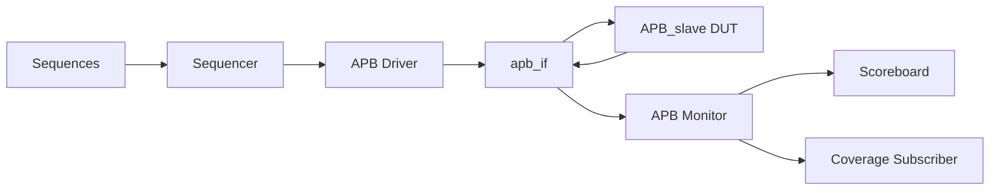
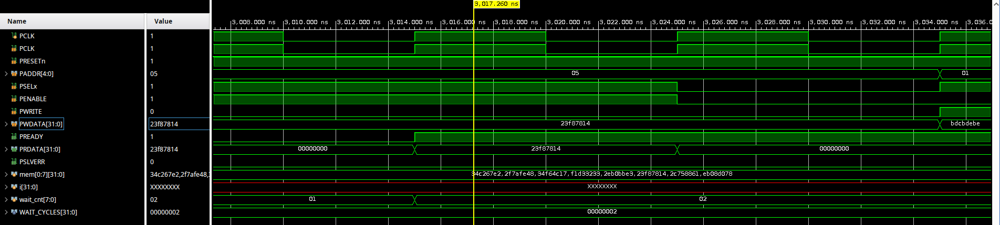

# APB UVM Verification Environment

This project verifies an APB3 slave memory using a SystemVerilog UVM testbench in Vivado/XSim.

## Overview

The repository keeps the working Vivado source layout intact and adds GitHub-ready documentation, scripts, and ignore rules around it.

Key facts:

- DUT: `APB_slave.sv`
- Simulation top: `tb_top.sv`
- Tool: Vivado/XSim 2023.2
- Data width: 32-bit
- Address width: 5-bit
- Valid memory addresses: `0x0` to `0x7`
- Out-of-bounds addresses: `0x8` to `0x1F`
- OOB accesses assert `PSLVERR`
- Default wait-state setting: `WAIT_CYCLES=2`
- Reset clears memory to zero

## DUT Summary

The DUT is a small APB3 slave RAM with eight 32-bit locations. Valid transactions complete after the configured wait-state count, while invalid addresses raise `PSLVERR`.

## Verification Environment

The UVM environment includes:

- a transaction class for APB read/write items
- a driver that speaks APB setup/access timing
- a monitor that captures completed transfers and reset events
- a scoreboard with a software golden memory model
- a coverage subscriber for valid addresses, OOB addresses, wait states, and protocol outcomes

## Test Scenarios

- Read-before-write sweep over all valid addresses
- Random valid write/read traffic
- Back-to-back valid transfers
- Single illegal-address error check
- Full OOB sweep from `0x08` to `0x1F` for both read and write
- Mid-test reset validation

## Assertions

Protocol checks are implemented in `apb_if.sv` and cover:

- APB setup phase behavior
- APB access phase behavior
- address stability during wait states
- write-data stability during wait states
- `PENABLE` deassertion after completion
- `PSLVERR` only being meaningful when `PREADY` is asserted

## Functional Coverage

Coverage is implemented in `apb_coverage.sv` and tracks:

- valid address bins for `0x0` to `0x7`
- full address bins for valid and OOB addresses
- read and write operations
- `PSLVERR` behavior
- wait-state bins for zero, one, and multi-wait transfers
- address x operation cross coverage
- `PSLVERR` x operation cross coverage

## Coverage Report

The latest Xcrg report shows a coverage score of `90.4762%` for the single `apb_coverage` instance.

What is fully covered:

- `cp_paddr` at `100%`
- `cp_paddr_full` at `100%`
- `cp_pwrite` at `100%`
- `cp_pslverr` at `100%`
- `cross_addr_op` at `100%`
- `cross_err_op` at `100%`

What is not fully covered:

- `cp_wait_states` at `33.33%`: only the `multi_wait` bin is hit, because the recorded run used `WAIT_CYCLES=2`. Closing the `zero_wait` and `one_wait` bins requires additional runs with `WAIT_CYCLES=0` and `WAIT_CYCLES=1`, then merging the coverage databases with `xcrg`.

The detailed report is in `reports/coverage/xcrg_report/xcrg_func_cov_report.txt`.

## Repository Structure

The working Vivado files stay in place:

- `apb_uvm.srcs/sources_1/new/APB_slave.sv`
- `apb_uvm.srcs/sim_1/new/*.sv`
- `apb_uvm.xpr`

Added packaging content lives in:

- `scripts/`
- `docs/`
- `reports/`
- `waves/`
- `.gitignore`

## Running the Simulation

The existing Vivado-generated XSim flow can be reused without moving files:

- open `apb_uvm.xpr` in Vivado and run Behavioral Simulation
- or, after Vivado has generated the simulation tree, run the helper script in `scripts/run_existing_vivado_sim.sh`

Note: `apb_uvm.sim/` is generated by Vivado and is excluded by `.gitignore`, so it is not present in a fresh clone. Open the project in Vivado and launch the simulation once before using the helper script.

## Generating Coverage Reports

Coverage data is already produced by the XSim run under the Vivado simulation tree. Use `scripts/gen_coverage_report.sh` to copy or summarize the existing coverage artifacts into `reports/coverage/`.

## Waveform Example

The waveform above is the APB read example discussed in `docs/waveform_analysis.md`.

## Current Results

The latest recorded `apb_reset_test` run completed successfully with:

- `UVM_INFO = 142`
- `UVM_WARNING = 0`
- `UVM_ERROR = 0`
- `UVM_FATAL = 0`
- simulation end time: `8985 ns`
- XSim runtime: `100000 ns`

Observed passing checks include:

- read-before-write reset behavior
- valid write/read comparison
- back-to-back transfers
- OOB `PSLVERR` behavior
- mid-test reset recovery

## Known Limitations and Future Work

- **Scoreboard does not flag a missing `PSLVERR`.** Errors are checked only when the DUT asserts `PSLVERR`; an OOB access that completes without `PSLVERR` is not reported. Add an explicit check that `paddr > 7` always produces `PSLVERR`.
- **Back-to-back transfers include an idle cycle.** The driver deasserts `PSELx` after every transfer, so transfers with `PSELx` held high between them are not exercised. The `$rose(PSELx)`-based assertions would also need updating to cover that case.
- **Wait-state coverage is incomplete.** `WAIT_CYCLES` is a compile-time parameter, so only one wait-state bin is hit per run (see Coverage Report).
- **No clocking blocks.** The driver and monitor sample `vif` signals directly at `posedge PCLK`; clocking blocks would remove potential sampling races.
- **Assertion gaps.** `PWRITE` and `PSELx` stability during wait states, X/Z checks on control signals, and a `PREADY` timeout are not yet asserted.
- **Mid-transfer reset.** The driver does not abort an in-flight transfer when `PRESETn` is asserted.
